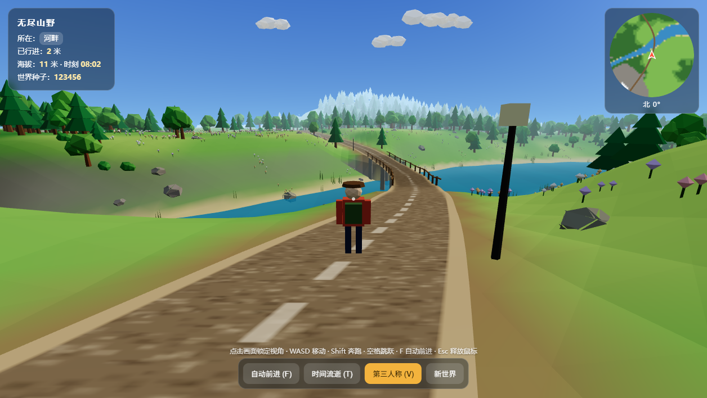
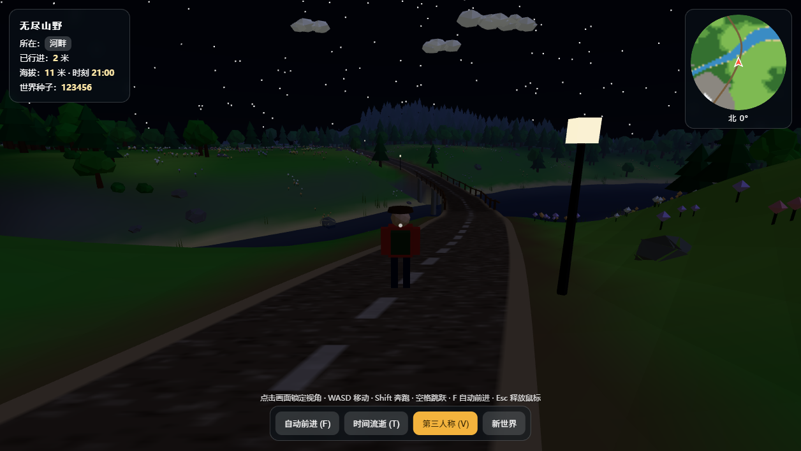
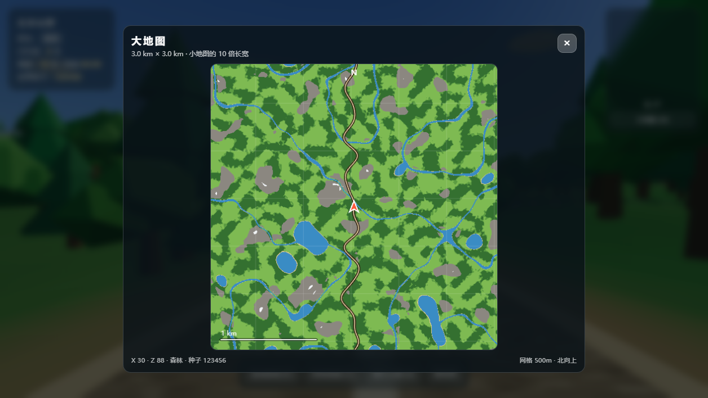
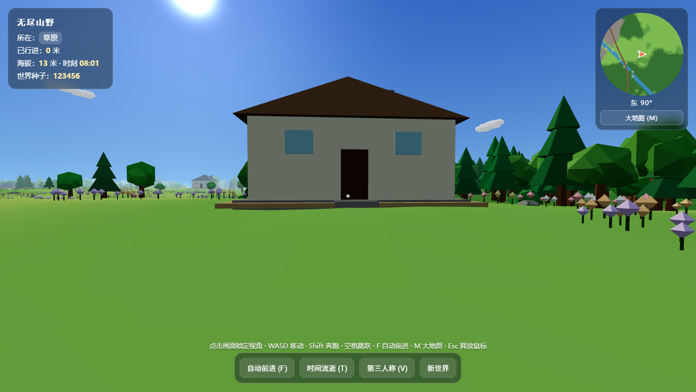
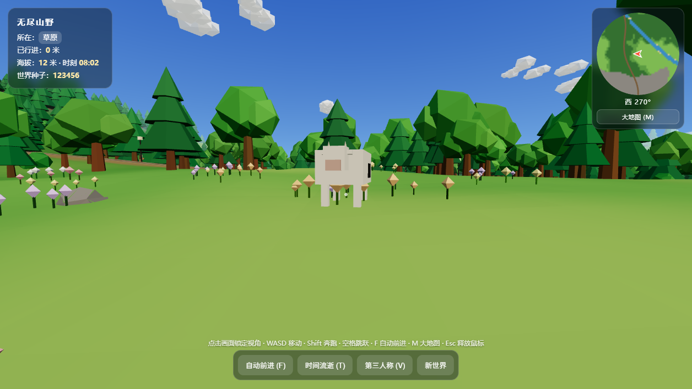

# 无尽山野（Endless Wild）

一个用 **TypeScript + Three.js + Vite** 重写的无限程序化探索小游戏。向前走，世界会在你脚下生成：森林、河流、湖泊、山坡、雪山与连绵的沙漠，昼夜交替，沿路还有路灯、桥与固定房屋；飞鸟、游鱼、兔子、蛇、牛、鹿会在周围活动，沙漠里则只有蜥蜴、骆驼与稀疏的仙人掌，沙丘之间的低洼处偶尔还藏着一片树林环绕的绿洲湖泊。按 `M` 可以打开 3km 范围大地图；右上角小地图下方还有一台 760m 高空的天穹摄像机，点击即可俯瞰附近地形。

原始版本是根目录下单个 `index.html`（744 行、全部逻辑内联）。本仓库把它拆分成了可维护、可测试、可构建的现代前端工程；原文件完整保留在 [`legacy/index.original.html`](legacy/index.original.html) 作为对照。



夜间会自动点亮路灯、浮现星空：



## 技术栈

- **TypeScript 5.6（strict）**：`noUnusedLocals`、`noUnusedParameters`、`verbatimModuleSyntax` 全开。
- **Vite 5.4**：本地 dev / 生产 build / preview。
- **Three.js 0.186.1**：升级到当前最新版，配合 `@types/three@0.186.0`；新版要求 WebGL 2，启动时会做能力检测。
- **Vitest 2.1**：纯逻辑单元测试。
- 无前端框架，HUD 与触摸控件全部是原生 DOM + CSS。

## 快速开始

要求 Node.js >= 20（开发时使用 Node 24）。

```bash
# 安装依赖（推荐 pnpm；项目内含 pnpm-lock.yaml）
pnpm install

# 本地开发，热更新
pnpm dev
# → http://127.0.0.1:5173/

# 类型检查 + 生产构建
pnpm build

# 本地预览构建产物
pnpm preview
# → http://127.0.0.1:4173/

# 只做类型检查 / 运行单元测试
pnpm typecheck
pnpm test
```

使用 npm 也可以：

```bash
npm install
npm run dev
npm run build
npm run preview
```

> 本机全局 npm 源仍是已停用的旧 taobao 源（证书过期），因此项目内 `.npmrc` 固定使用官方源。pnpm 11 默认禁止依赖执行安装脚本，`pnpm-workspace.yaml` 已显式允许 `esbuild` 的 postinstall。

## 操作

| 输入 | 行为 |
| --- | --- |
| `W A S D` / 方向键 | 前后左右移动 |
| 点击画面 / 鼠标 | 锁定视角环顾；也支持按住拖拽 |
| `Shift` | 奔跑 |
| `空格` | 跳跃 |
| `F` | 沿道路自动前进 |
| `-` / `=` | 减速 / 加速移动（预设档位） |
| `T` | 加速时间流逝 |
| `V` | 切换第一 / 第三人称 |
| `M` / 点击小地图 | 打开 / 关闭 3km 大地图 |
| `N` / 点击天穹视图或下方「天穹大视野」按钮 | 打开 / 关闭天穹俯瞰大视野 |
| `P` / 点击底部「存档」 | 打开存档面板：保存 / 载入 / 导入 / 导出存档文件 |
| 大视野内按住地图拖动 | 转向（不请求鼠标锁定，可继续点按钮） |
| `Esc` | 关闭存档面板 → 天穹视角 → 大地图 / 释放鼠标 |
| 触屏 | 左下摇杆移动、右侧按钮跳跃、空白处拖动视角 |

### 速度系统

- 倍率范围为 **0.5×–7×**，同时缩放水平移动速度（走路 / 奔跑 / 游泳）与跳跃初速，重力保持不变；
- `-` / `=` 在预设档位 **0.5× / 1× / 1.5× / 2× / 3× / 4× / 5× / 6× / 7×** 间切换；
- 底部操作栏的滑杆可在范围内连续微调，右侧实时显示当前倍率；
- 自动前进的转向速率也随倍率提高，避免高速时在弯道切出路面；
- 调试接口：`window.__wild.getSpeed()` / `window.__wild.setSpeed(2)`。

## 大地图

按 `M` 或点击右上角小地图，可以打开以玩家为中心的大地图：

- 显示范围 **3.0 km × 3.0 km**，正好是当前小地图（300m）的 **10 倍长宽 / 100 倍面积**
- 北向上，包含道路、地形色、湖泊河流、500m 网格、1km 比例尺和玩家朝向
- 地形在打开时按行分片生成（512×512，每片约 12ms），带进度提示，不阻塞输入
- **打开后游戏不暂停**：仍可用 `WASD` / `F` 自动前进继续走，地图每 0.1s 以像素平移 + 只重采样新露出边条的方式跟随玩家滚动（单次位移超过 48px 才整体重画），画面始终以玩家为中心
- **可以转向**：按住地图画面拖动即可转动主角（不使用 Pointer Lock，光标仍可用于关闭按钮）



## 天穹摄像机

右上角小地图下方常驻一个 **天穹视角** 缩略图（上方是「大地图 (M)」按钮，下方是同样样式的「天穹大视野 (N)」按钮）：镜头架在玩家正上方 **760m** 高空垂直向下俯瞰，视野约 **583m**，北向上。按 `N`、点击缩略图或下方的天穹大视野按钮都能打开大视野，再按一次 `N` 关闭。

- 缩略图 4fps 刷新；打开大视野后画面**每帧**都按玩家位移做像素平移（主角永远在画面中心），3D 俯瞰本身只需 12fps 重渲染（512×512），走动时既跟手又不会让主视角掉帧
- 中心只画一团**从红到透明的渐变光晕**标记主角所在区域（没有圆环也没有箭头，避免挡住主角本体）
- 俯瞰用的是同一个相机与同一次渲染：借用主画布角落按 scissor 画一帧后立刻拷到 UI 画布，随后主视角渲染覆盖，因此不需要离屏 RenderTarget 或同步回读
- **像素预算**：俯瞰的设备像素数被限制在 UI 画布分辨率以内（512 / 256），Retina 与 150% 缩放屏幕上不再按 768~1024 的方形填充，打开大视野时不会掉帧；覆盖层的全屏 `backdrop-filter` 也已移除（每帧重新模糊整屏同样很贵）
- 俯瞰期间临时把雾推到 460–1500m 并隐藏云层（云在镜头与地面之间会挡住地形），结束后恢复
- 视野尺寸受已加载区块限制：对角半径约 412m < 已加载的 448m，四角不会露出虚空
- **打开大视野时同样不暂停**：`WASD` 行走时俯瞰画面实时跟随，按住地图拖动可转向；大地图与天穹大视野互斥，按 `Esc` 或关闭按钮退出后自动重新锁定鼠标
- 调试接口：`window.__wild.openSkyView()` / `closeSkyView()` / `isSkyViewOpen()` / `isBigMapOpen()`。

## 实时帧率

左上角 HUD 在天气下方显示 **最近 0.5 秒的平均帧率**（`帧率：140 FPS`），低于 50 / 30 帧时数字会变成黄色 / 红色，方便快速判断掉帧程度。

- 统计走独立的时间窗口（`performance.now()`），不使用主循环的 `dt`：主循环会把长帧截断到 50ms，用截断后的 `dt` 反推帧率会偏高；
- 0.5 秒窗口既能及时反映掉帧，又不会让数字每帧乱跳；数字使用等宽字形，避免面板宽度抖动；
- 控制台可用 `window.__wild.getFps()` 读到同一数值，用 `window.__wild.renderStats()` 查看最近一次主视角渲染的 `drawCalls / triangles / geometries / textures` 与已加载区块数，用于对照分析掉帧。

## 存档

按 `P` 或点击底部「存档」按钮打开存档面板。存档记录的是 **当前种子世界 + 玩家当前位置 / 朝向 / 行走距离 + 时刻**，默认保存在浏览器 `localStorage`，也可以导出成 JSON 文件带走或分享。

- **本地存档**：面板里点「保存到本地」写入 `localStorage['wild-save-v1']`；「载入本地存档」立即把玩家放回保存点；「删除本地存档」清空本地存档。
- **导出**：点「导出存档文件」下载 `endless-wild-<种子>-YYYYMMDD-HHMM.json`，内容是可读的 JSON。
- **导入**：点「导入存档文件」选择之前导出的存档。**种子相同**时立即生效；**种子不同**时会把 URL 的 `seed` 改成存档里的种子并整页重载，重载后自动续档。
- **启动自动续档**：只有本地存档的种子与当前世界一致时才会回到保存点；`?seed=` 参数和上次游玩的世界优先于存档种子，因此旧存档不会把新世界拉回去。
- **世界不变**：存档只恢复玩家与时刻，地形、植被、房屋、道路等仍由种子确定性生成；空中存档会保留高度并让重力把角色自然落下，低于地面的存档点会被抬回地表。
- **扩展区**：存档 JSON 里的 `sections` 是给后续系统（背包、任务、天气等）预留的扩展槽位，读取时会原样保留未知键，新增系统不会破坏旧存档。
- **面板不暂停游戏**：与大地图 / 天穹大视野互斥，打开时退出 Pointer Lock，按 `Esc` 依次关闭存档面板 → 天穹 → 大地图。
- 调试接口：`window.__wild.saveGame()` / `loadGame()` / `getLocalSave()` / `exportSaveText()` / `importSaveText(text)`。

### 新增可存档系统

以背包为例，在 `Game` 装配 `SaveService` 之后注册一个 section，其余序列化、校验、导入导出、跨种子重载都由 `SaveService` 统一处理：

```ts
save.registerSection({
  key: 'inventory',
  capture: () => ({ items: inventory.serialize() }), // 返回 undefined 表示本次不写入
  restore: (value) => inventory.restore(value as { items: InventoryItem[] }),
});
```

`src/save/` 的分工：`types.ts` 存档结构与版本号、`codec.ts` 校验与读写 / 文件名、`SaveStore.ts` localStorage 读写与降级、`SaveService.ts` 快照 / 恢复 / 扩展段注册、`download.ts` 文件下载、`ui/SavePanel.ts` 面板交互。

## 房屋与野生动物

- **房屋是固定景物**：由 `seed + 区块坐标` 确定性生成，选址要求房屋周围 16m 内基本平坦、干燥，不能压在水面或道路上；离开再回来仍是同一栋房子，并带碰撞。
- **动物按合理地形生成**：
  - 鸟：盘旋、振翅、缓慢转向，也会落到地面休息再起飞——每只鸟**地面停留 : 空中飞行 = 1 : 3**（飞 15~26 秒、落地休息 5~8.7 秒），落地时收翅、起飞时重新展开；水面与浅滩不落；
  - 鱼：只生成在水里，在水面下游动；
  - 兔子：走走停停、短距离蹦跳，玩家靠近会快速逃走；
  - 蛇：低伏蛇行，受惊后加速；
  - 牛：只选平坦开阔地，长时间吃草、慢慢移动；
  - 鹿：开阔林地活动，警觉范围更大、逃得更快。
- **性能优先**：鸟只用 3 个 `InstancedMesh`（身体 + 左右翼），鱼和每种地面动物各 1 个；动物不记录行走路径、不做玩家碰撞，走离玩家一定距离直接销毁，回来重新在合理地点随机生成。

## 沙漠

- **成片分布**：沙漠由 20km 网格单元内的大圆生成，单块直径至少 13km，正常步速穿越要超过一个游戏日；单块半径收缩后，全世界沙漠约占 1/5，不会出现零散的小沙斑。另外沿道路每隔 28km 保证一块完整沙漠，因此沿路往任意方向走，前后 10km 内一定能遇到沙漠，出生点本身也不会落在沙漠里。
- **沙丘地貌**：少而大的沙丘——约 2.2km 波长的主沙丘（最高约 58m，达到小山规模）、约 1km 波长的次级隆起、385m 与 180m 两道经过 `smoothstep` 柔化的沙脊，以及细沙纹；丘顶与丘间盆地之间是宽缓过渡，不会出现尖锐棱线。最低处约 5.5m，仍高于最高水位，因此沙漠里（除绿洲外）绝不会出现河流、湖泊。
- **绿洲**：按 5km 网格生成，每格最多一个、且只有 40% 的格子会真的生成（平均约 1 个/45km² 沙漠，相邻绿洲中心实测间距超过 3km）。绿洲选址在沙漠核心最低的沙丘洼地里：中心挖出低于水位的湖盆，全局水面直接形成湖泊，湖岸外是一圈高出水面的树林台地，再用 120m 过渡带平滑爬回沙丘。湖岸与外边界都在距离场上叠加了两档低频噪声扰动（湖岸约 ±50m、外边界约 ±80m），所以湖水与整片绿洲都是有柔软凹凸的有机形状，而不是正圆；芦苇与树林也贴着扰动后的岸线生长。绿洲直径约 1km（轮廓起伏后 0.85–1.2km），在小地图上呈一块清晰的深绿色；绿洲里生活的是沙漠之外的普通动物，它们走不出绿洲，沙漠动物也不会走进来。
- **渐变过渡**：`desertAt()` 的 0–1 因子同时驱动地表颜色、植被密度、动物生境、积雪遮罩和天气强度，交界处从草木到沙地平滑过渡；`oasisAt()` 再从沙漠因子里扣出绿洲这一块独立生境。
- **专属内容**：沙漠里只有稀疏的仙人掌，分高柱、普通柱状、桶状三种株型，高矮和颜色都有明显差异；地面动物为小蜥蜴和骆驼；建筑统一为帐篷，村民换成阿拉伯风格装扮。沙丘上的小蜥蜴数量略微增加，视野里通常能看到一两只。
- **岩柱与石头**：风蚀岩柱改成固定格网生成——600m 网格、每 3 格选 1 格，任意 1000×1000m 内最多 3 根，单根高 10–24m，成为真正的地标；石头按 350m 网格每格最多一块，任意 1000×1000m 内不超过 16 块。
- **调试传送**：底部操作栏的「去沙漠」按钮会把玩家直接放到最近的沙漠边缘并面朝沙漠，等价于控制台执行 `window.__wild.toDesertEdge()`；「去绿洲」按钮会把玩家放到最近的绿洲湖岸边、面朝湖心，等价于 `window.__wild.toOasisEdge()`。
- **天气限制**：靠近沙漠时雨雪逐步减弱直至完全停止，核心区强制晴天；进入沙漠后底部天气控件禁用，普通地形的积雪也不会把沙地染白。





## 目录结构

```
.
├─ index.html                     # 仅保留 DOM 骨架，逻辑从 src/main.ts 进入
├─ public/favicon.svg
├─ src/
│  ├─ main.ts                     # 启动入口与顶层错误兜底
│  ├─ app/
│  │  └─ Game.ts                  # 依赖装配、主循环顺序、UI 状态同步
│  ├─ core/
│  │  ├─ GameLoop.ts              # requestAnimationFrame 循环 + 长帧限幅
│  │  └─ dom.ts                   # 必需的 DOM 元素 / 2D 上下文获取
│  ├─ config/                     # 所有可调参数集中在这里
│  │  ├─ world.ts                 # 区块、道路、种子
│  │  ├─ terrain.ts               # 山地、丘陵、河流、湖泊的振幅 / 频率 / 阈值
│  │  ├─ desert.ts                # 沙漠分布、沙丘参数与天气抑制阈值
│  │  ├─ oasis.ts                 # 绿洲分布网格、湖泊与树林环带尺寸
│  │  ├─ wildlife.ts              # 动物数量、速度、停走、逃跑与销毁距离
│  │  ├─ render.ts                # 相机、雾、天空、水、云
│  │  ├─ player.ts                # 移动、跳跃、相机跟随
│  │  ├─ input.ts                 # 鼠标 / 触摸灵敏度
│  │  ├─ ui.ts                    # HUD / 小地图 / 大地图参数
│  │  └─ daynight.ts              # 昼夜速度
│  ├─ math/                       # 无框架依赖的纯函数
│  │  ├─ random.ts                # xorshift32 + 区块哈希
│  │  ├─ noise.ts                 # 可复现二维 simplex 噪声
│  │  ├─ scalar.ts                # clamp / lerp / smoothstep
│  │  └─ angle.ts
│  ├─ world/                      # 世界模型与网格生成
│  │  ├─ World.ts                 # 世界采样门面
│  │  ├─ NoiseFields.ts           # 9 层噪声的固定创建顺序
│  │  ├─ TerrainSurface.ts        # 山地、湖泊、河流、森林场、沙丘与绿洲
│  │  ├─ RoadTrack.ts             # 道路中心线 / 路面高度 / 桥判定
│  │  ├─ TerrainColoring.ts       # 顶点色与小地图配色
│  │  ├─ Biomes.ts
│  │  ├─ seed.ts                  # URL / localStorage / 随机种子
│  │  ├─ spawn.ts                 # 沿道路寻找干燥、开阔、平缓的出生点
│  │  ├─ desertTravel.ts          # 寻找最近的沙漠边缘（调试传送按钮）
│  │  ├─ landmarks/Houses.ts      # 固定房屋的选址与低模几何
│  │  ├─ landmarks/Tents.ts       # 沙漠帐篷的选址附加物与低模几何
│  │  ├─ WorldMaterials.ts        # 共享材质
│  │  ├─ assets/                  # 植被、道路设施的低模几何体
│  │  └─ streaming/
│  │     ├─ ChunkMeshBuilder.ts   # 地形顶点位移 + 顶点色 + 植被
│  │     ├─ VegetationScatter.ts  # 区块内确定性撒点
│  │     ├─ RoadMeshBuilder.ts    # 弯曲路面、桥、栏杆、路灯
│  │     ├─ WorldStreamer.ts      # 区块 / 道路段的加载与卸载
│  │     └─ types.ts
│  ├─ render/                     # 与玩法无关的渲染基础设施
│  │  ├─ Viewport.ts              # Renderer / Scene / Camera
│  │  ├─ instancing.ts            # InstancedMesh 批量提交
│  │  ├─ geometry/                # 几何体合并、顶点色烘焙
│  │  ├─ textures/roadTexture.ts  # Canvas 生成的土路贴图
│  │  └─ environment/             # 光照、天空、星空、水、云、昼夜快照
│  ├─ systems/
│  │  └─ DayNightCycle.ts         # 时刻推进 → 光照快照
│  ├─ player/                     # 玩家领域
│  │  ├─ Player.ts                # 纯数值物理与状态
│  │  ├─ Hero.ts                  # 第三人称角色与走路动画
│  │  └─ CameraRig.ts             # 第一 / 第三人称相机
│  ├─ save/                       # 存档（本地槽位 + 导入导出）
│  │  ├─ types.ts                 # 存档结构、格式与版本号
│  │  ├─ codec.ts                 # 校验、序列化、摘要、文件名
│  │  ├─ SaveStore.ts             # localStorage 读写与不可用降级
│  │  ├─ SaveService.ts           # 快照 / 恢复 / sections 扩展段注册
│  │  └─ download.ts              # 导出下载
│  ├─ input/                      # 键盘、鼠标、触摸 → 统一输入
│  │  ├─ Keyboard.ts
│  │  ├─ PointerLook.ts
│  │  ├─ TouchControls.ts
│  │  ├─ InputManager.ts
│  │  ├─ pointerLock.ts
│  │  └─ types.ts
│  ├─ ui/                         # DOM HUD
│  │  ├─ Hud.ts
│  │  ├─ Minimap.ts
│  │  ├─ BigMap.ts                # 3km 大地图：分片采样 + 道路/网格/标记
│  │  ├─ SkyView.ts               # 天穹摄像机：高空俯瞰缩略图 + 大视野
│  │  ├─ SavePanel.ts             # 存档面板：保存 / 载入 / 导入 / 导出
│  │  ├─ StartScreen.ts
│  │  ├─ Toolbar.ts
│  │  ├─ SpeedControl.ts           # 速度倍率：档位按钮 + 滑杆
│  │  └─ format.ts
│  ├─ styles/                     # 按职责拆分的 CSS
│  │  ├─ base.css
│  │  ├─ hud.css
│  │  ├─ controls.css
│  │  ├─ overlays.css
│  │  ├─ touch.css
│  │  ├─ bigmap.css
│  │  ├─ save.css
│  │  ├─ responsive.css
│  │  └─ main.css                 # 只做 @import 汇总
│  └─ types/global.d.ts           # window.__wild 调试接口
├─ tests/                         # Vitest 单元测试
│  ├─ math/
│  ├─ save/                       # 存档校验、存储与扩展段
│  ├─ ui/
│  └─ world/
├─ docs/ARCHITECTURE.md           # 分层、主循环、确定性约定、扩展指南
├─ legacy/index.original.html     # 原始单文件版本（仅作参考，不参与构建）
├─ vite.config.ts
├─ vitest.config.ts
└─ tsconfig.json
```

## 架构概览

整体是“**纯逻辑内核 + 渲染适配层 + 应用编排层**”的结构：

```text
app/Game.ts
   ├─ 输入  input/  ───────────────┐
   ├─ 玩法  player/ + systems/     │ 每帧输入 → 物理 → 世界流式加载
   ├─ 世界  world/ ── render/      │ → 相机 → 环境 → UI → render
   ├─ 表现  render/ environment/   │
   └─ 界面  ui/ + styles/ ─────────┘
```

- `World`、`Player` 等核心对象不依赖 DOM，便于单测与替换。
- 渲染对象只消费世界数据，不反向修改世界。
- 所有“魔法数字”收敛到 `src/config/`；地形与水体参数在 `src/config/terrain.ts`。
- 河湖使用“低频大特征 + 较高阈值”控制：单个水体更大，但总量和道路穿越次数更少。
- 世界生成由种子唯一决定；区块卸载再加载不会改变内容。
- **视野**：区块加载半径 7 格（约 448m），雾距 65–420m，1km 水面平面跟随玩家，远处地形一直铺到雾里；外圈（半径 5 格 ≈ 320m 以外）只生成地形，走近后再补上植被、房屋与碰撞体，所以扩大视野不会等比例增加绘制调用。
- 共享几何体 / 材质只在 `Game` 生命周期内创建一次，区块销毁时只释放本区块独有的资源。

更详细的主循环顺序、随机数消耗约定和扩展步骤见 [`docs/ARCHITECTURE.md`](docs/ARCHITECTURE.md)。

## 种子与调试

- URL `?seed=123456` 优先，其次 `localStorage` 的 `wild-seed`（上次游玩的世界），再其次本地存档里的种子，最后随机。这样导入跨种子存档时能切到存档世界，而旧存档不会把新世界拉回去。
- 点击“新世界”会生成新种子并刷新页面。
- 控制台可直接使用：

```js
window.__wild.player          // 玩家状态
window.__wild.world.height    // 世界高度采样
window.__wild.height(x, z)
window.__wild.desertAt(x, z)  // 沙漠因子：1 = 核心沙漠，0 = 普通地形
window.__wild.desertFactor()  // 玩家当前所在位置的沙漠因子
window.__wild.toDesertEdge()  // 传送到最近的沙漠边缘
window.__wild.toOasisEdge()   // 传送到最近的绿洲湖边
window.__wild.chunks.size     // 当前已加载区块数
window.__wild.roads.size
window.__wild.camera
window.__wild.setAuto(true)   // 自动前进
window.__wild.getSpeed()      // 当前移动速度倍率
window.__wild.setSpeed(2)     // 设为 2 倍速
window.__wild.getHour()       // 当前时刻
window.__wild.setHour(21)     // 直接调到夜间，方便截图/调光
window.__wild.wildlifePopulation()  // 各类动物当前数量
window.__wild.wildlifeSightings()   // 各类动物当前位置；鸟还带 id 与 mode（fly / landing / perched / takeoff）
window.__wild.getFps()              // 实时帧率（与 HUD 一致）
window.__wild.renderStats()         // drawCalls / triangles / geometries / textures / chunks
window.__wild.saveGame()            // 保存到本机，返回 { outcome, message, data }
window.__wild.loadGame()            // 载入本地存档（跨种子会自动重载到存档世界）
window.__wild.getLocalSave()        // 读本地存档（无 / 损坏时返回 null）
window.__wild.exportSaveText()      // { name, text }，可直接下载或复制
window.__wild.importSaveText(text)  // 导入存档 JSON 文本
window.__wild.openSavePanel()       // 打开存档面板（等价于按 P）
window.__wild.didRestoreSave()      // 本次启动是否从本地存档续档
```

`window.__wild` 保留了原始版本的调试入口，方便对比和二次开发。

## 构建与部署

`pnpm build` 会先执行 `tsc --noEmit`，再由 Vite 输出到 `dist/`。`vite.config.ts` 里使用 `base: './'`，因此构建产物可以部署在任意子路径，例如 GitHub Pages、对象存储或现有静态站点目录。

产物结构：

```text
dist/
├─ index.html
├─ favicon.svg
└─ assets/
   ├─ index-*.js        # 业务代码
   ├─ three-*.js        # Three.js 单独分块，便于长期缓存
   ├─ index-*.css
   └─ *.map
```

## 测试

`tests/` 覆盖了与视觉无关但最容易回归的部分：

- 随机数与噪声的可复现性；
- `smoothstep` 的反向边界；
- 世界高度 / 道路贴合的有限性与确定性；
- 河湖占比、道路穿越次数、坡度分布与缓坡占比；
- 出生点是否干燥、开阔、平缓；
- 大地图范围是否确为小地图的 10 倍长宽；
- 天穹摄像机的高度、视野宽度是否与已加载区块半径匹配，雾与刷新频率是否合理；
- 固定房屋是否确定性生成、周围平坦且避开水面；
- 种子优先级与回退；
- 存档的校验与降级（坏 JSON / 错误格式 / 超前版本 / 非法坐标 / 种子 0）、本地槽位读写、同种子恢复、跨种子重载与 `sections` 扩展段往返；
- 昼夜光照与路灯 / 星空；
- HUD 时刻、罗盘格式化。

```bash
pnpm test
```

## 已知边界

- 需要支持 **WebGL 2** 的浏览器（Three.js r163+ 已移除 WebGL 1 支持）；不支持时页面会显示明确的加载失败提示。
- Pointer Lock 需要用户手势，点击“开始探索”或画面后才会生效；部分移动端浏览器不提供。
- 世界生成在主线程同步执行，每帧有构建预算控制；极低端设备上首次进入仍可能有短暂卡顿。
