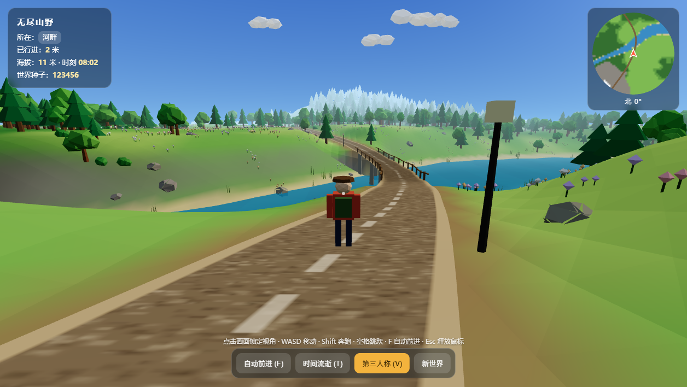
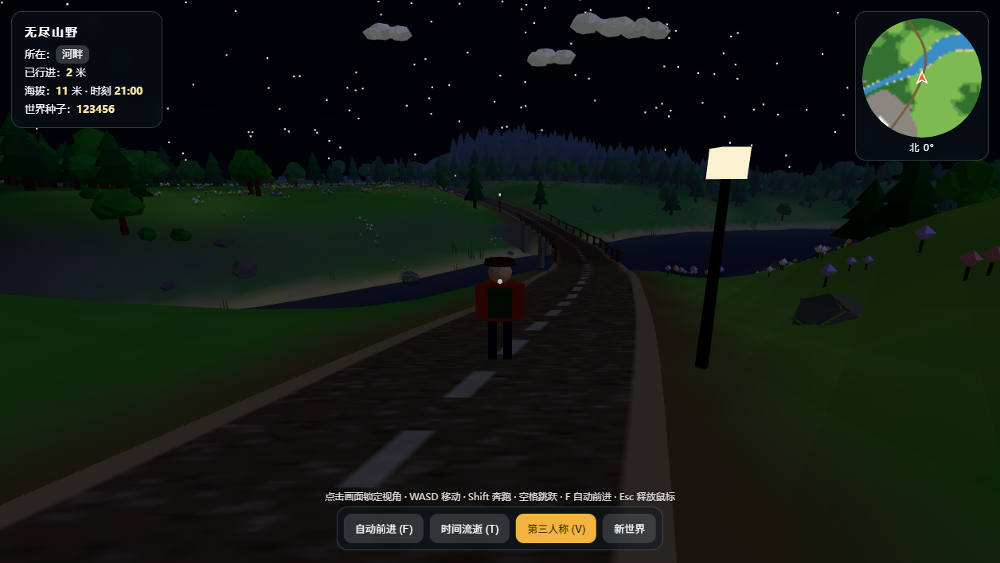
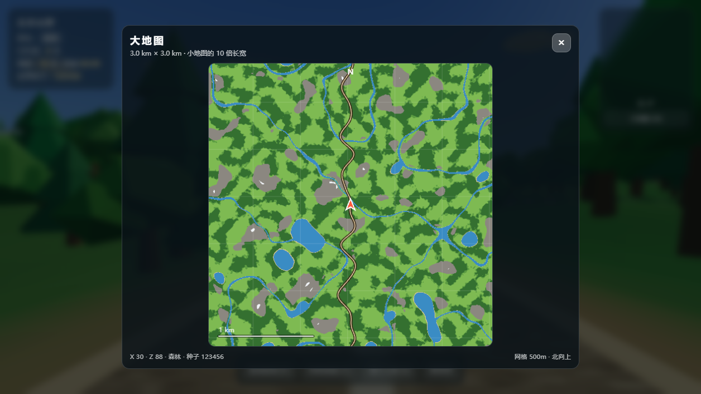
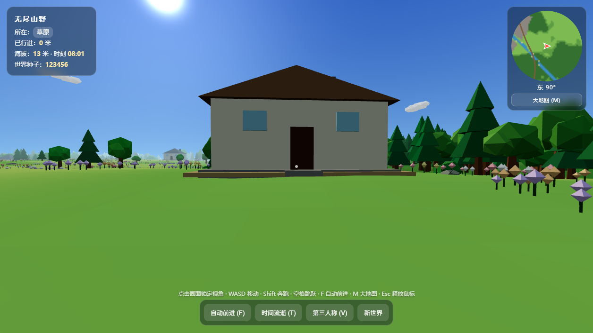
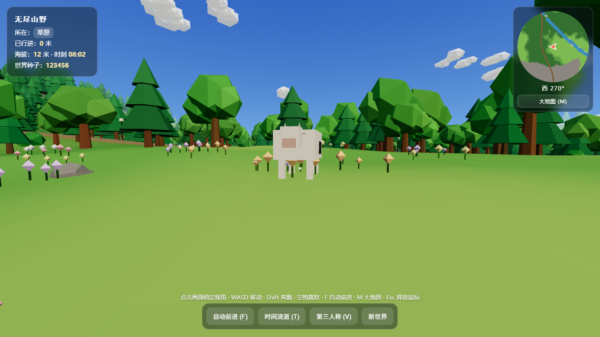
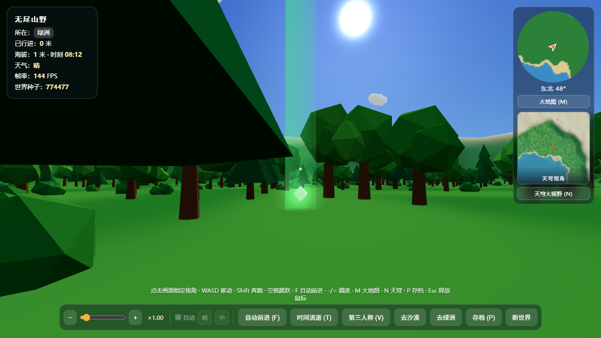

# 无尽山野（Endless Wild）

一个用 **TypeScript + Three.js + Vite** 重写的无限程序化探索小游戏。向前走，世界会在你脚下生成：森林、河流、湖泊、山坡、雪山与连绵的沙漠，昼夜交替，沿路还有路灯、桥与固定房屋；飞鸟、游鱼、兔子、蛇、牛、鹿会在周围活动，沙漠里则只有蜥蜴、骆驼与稀疏的仙人掌，沙丘之间的低洼处偶尔还藏着一片树林环绕的绿洲湖泊。按 `M` 可以打开 3km 范围大地图；解锁「天穹视角」后，右上角小地图下方会多出一台 760m 高空的天穹摄像机，点击即可俯瞰附近地形。

开局即可 **行走、跳跃与查看背包**，地图、视角控制与 `F` 自动前进也始终可用；其余功能全部处于封印状态。捡到的宝石可以在 **合成台（`C`）** 里按各自图纸摆成阵形，合成一次即永久解锁一项功能。宝石越稀有、图纸越复杂，解锁的功能就越强。

原始版本是根目录下单个 `index.html`（744 行、全部逻辑内联）。本仓库把它拆分成了可维护、可测试、可构建的现代前端工程；原文件完整保留在 [`legacy/index.original.html`](legacy/index.original.html) 作为对照。



夜间会自动点亮路灯、浮现星空：



## 技术栈

- **TypeScript 5.6（strict）**：`noUnusedLocals`、`noUnusedParameters`、`verbatimModuleSyntax` 全开。
- **Vite 5.4**：本地 dev / 生产 build / preview。
- **Three.js 0.186.1**：升级到当前最新版，配合 `@types/three@0.186.0`；新版要求 WebGL 2，启动时会做能力检测。
- **Vitest 2.1**：纯逻辑单元测试。
- 无前端框架，HUD 与触摸控件全部是原生 DOM + CSS。

## 快速开始

要求 Node.js >= 20（开发时使用 Node 24）。

```bash
# 安装依赖（推荐 pnpm；项目内含 pnpm-lock.yaml）
pnpm install

# 本地开发，热更新
pnpm dev
# → http://127.0.0.1:5173/

# 类型检查 + 生产构建
pnpm build

# 本地预览构建产物
pnpm preview
# → http://127.0.0.1:4173/

# 只做类型检查 / 运行单元测试
pnpm typecheck
pnpm test
```

使用 npm 也可以：

```bash
npm install
npm run dev
npm run build
npm run preview
```

> 本机全局 npm 源仍是已停用的旧 taobao 源（证书过期），因此项目内 `.npmrc` 固定使用官方源。pnpm 11 默认禁止依赖执行安装脚本，`pnpm-workspace.yaml` 已显式允许 `esbuild` 的 postinstall。

## 操作

行走、跳跃、背包、地图、视角与 `F` 自动前进开局即可用；其余功能都需要先在合成台里解锁，未解锁时按钮会变暗并带 🔒。

| 输入 | 行为 |
| --- | --- |
| `W A S D` / 方向键 | 前后左右移动（默认可用） |
| 点击画面 / 鼠标 | 锁定视角环顾；也支持按住拖拽（核心功能，始终可用） |
| `Shift` | 奔跑（需合成「奔跑」） |
| `空格` | 跳跃（默认可用） |
| `F` | 沿道路自动前进（核心功能，始终可用） |
| `-` / `=` | 减速 / 加速移动（预设档位，需合成对应速度档） |
| `T` | 加速时间流逝（需合成「时间流逝」） |
| `V` | 切换第一 / 第三人称（需合成「第三人称」） |
| `M` / 点击小地图 | 打开 / 关闭 3km 大地图（核心功能，始终可用） |
| `N` / 点击天穹视图或下方「天穹大视野」按钮 | 打开 / 关闭天穹俯瞰大视野（需合成「天穹视角」，未解锁时两个入口整体隐藏） |
| `P` / 点击底部「存档」 | 打开存档面板：保存 / 载入 / 导入 / 导出存档文件（需合成「存档面板」） |
| `B` / 点击底部「背包」 | 打开 / 关闭背包面板：查看已经收集到的宝石（默认可用） |
| `C` / 点击底部「合成台」 | 打开 / 关闭功能合成台（始终可用） |
| 大视野内按住地图拖动 | 转向（不请求鼠标锁定，可继续点按钮） |
| `Esc` | 关闭合成台 → 背包 → 存档面板 → 天穹视角 → 大地图 / 释放鼠标 |
| 触屏 | 左下摇杆移动、右侧按钮跳跃、空白处拖动视角（摇杆与跳跃键默认可用） |

### 速度系统

- 倍率范围为 **0.5×–7×**，同时缩放水平移动速度（走路 / 奔跑 / 游泳）与跳跃初速，重力保持不变；
- 速度被拆成 **1–7 共 7 个独立档位**，每档都要单独合成（`×1.5 / ×2 / ×3 / ×4 / ×5 / ×6 / ×7`），档位越高图纸越复杂；
- 未解锁任何速度档时底部速度组整体禁用，倍率固定在 `×1.00`；
- `-` / `=` 在已解锁的预设档位间切换，底部操作栏的滑杆可在 `0.5×` 到当前上限之间连续微调；
- 自动前进的转向速率也随倍率提高，避免高速时在弯道切出路面；
- 调试接口：`window.__wild.getSpeed()` / `window.__wild.setSpeed(2)`。

## 大地图

按 `M` 或点击右上角小地图，可以打开以玩家为中心的大地图：

- 显示范围 **3.0 km × 3.0 km**，正好是当前小地图（300m）的 **10 倍长宽 / 100 倍面积**
- 北向上，包含道路、地形色、湖泊河流、500m 网格、1km 比例尺和玩家朝向
- 地形在打开时按行分片生成（512×512，每片约 12ms），带进度提示，不阻塞输入
- **打开后游戏不暂停**：仍可用 `WASD` / `F` 自动前进继续走，地图每 0.1s 以像素平移 + 只重采样新露出边条的方式跟随玩家滚动（单次位移超过 48px 才整体重画），画面始终以玩家为中心
- **可以转向**：按住地图画面拖动即可转动主角（不使用 Pointer Lock，光标仍可用于关闭按钮）
- **宝石雷达**：解锁「宝石雷达」后，小地图与大地图会叠加附近宝石的彩色光点（见下）



### 宝石雷达

「宝石雷达」是一张 **11 颗宝石** 的中阶图纸（蓝1 + 绿3 + 黄7），合成成功后两张地图会自动标出宝石：

- 每个光点用该宝石自身的光晕色（红 / 蓝 / 黄 / 绿 / 紫 / 钻 / 黑 / 荧光各自的 `glow` 色），荧光石同样按它当前色环取色；
- 小地图每帧重绘光点与朝向箭头，范围约 150m，超出范围的宝石不画；地形与道路底图仍是 0.4s 采样一次，因此开雷达不会额外增加地形采样开销；
- 大地图在每次滚动重绘时叠加光点，超出画布边缘的自动跳过；
- 点位数据直接来自 `GemManager.getSightings()`，`Game` 里按 0.25s 节流刷新一次，解锁状态变化时立即刷新一次；
- 未解锁时不显示任何光点，地图与之前完全一致。

## 天穹摄像机

**未解锁「天穹视角」时，缩略图与「天穹大视野」按钮整体隐藏**（`hidden`），合成成功后才会出现在小地图下方。解锁后，缩略图上方是「大地图 (M)」按钮，下方是同样样式的「天穹大视野 (N)」按钮：镜头架在玩家正上方 **760m** 高空垂直向下俯瞰，视野约 **583m**，北向上。按 `N`、点击缩略图或下方的天穹大视野按钮都能打开大视野，再按一次 `N` 关闭。

- 缩略图 4fps 刷新；打开大视野后画面**每帧**都按玩家位移做像素平移（主角永远在画面中心），3D 俯瞰本身只需 12fps 重渲染（512×512），走动时既跟手又不会让主视角掉帧
- 中心只画一团**从红到透明的渐变光晕**标记主角所在区域（没有圆环也没有箭头，避免挡住主角本体）
- 俯瞰用的是同一个相机与同一次渲染：借用主画布角落按 scissor 画一帧后立刻拷到 UI 画布，随后主视角渲染覆盖，因此不需要离屏 RenderTarget 或同步回读
- **像素预算**：俯瞰的设备像素数被限制在 UI 画布分辨率以内（512 / 256），Retina 与 150% 缩放屏幕上不再按 768~1024 的方形填充，打开大视野时不会掉帧；覆盖层的全屏 `backdrop-filter` 也已移除（每帧重新模糊整屏同样很贵）
- 俯瞰期间临时把雾推到 460–1500m 并隐藏云层（云在镜头与地面之间会挡住地形），结束后恢复
- 视野尺寸受已加载区块限制：对角半径约 412m < 已加载的 448m，四角不会露出虚空
- **打开大视野时同样不暂停**：`WASD` 行走时俯瞰画面实时跟随，按住地图拖动可转向；大地图与天穹大视野互斥，按 `Esc` 或关闭按钮退出后自动重新锁定鼠标
- 调试接口：`window.__wild.openSkyView()` / `closeSkyView()` / `isSkyViewOpen()` / `isBigMapOpen()`。

## 实时帧率

左上角 HUD 在天气下方显示 **最近 0.5 秒的平均帧率**（`帧率：140 FPS`），低于 50 / 30 帧时数字会变成黄色 / 红色，方便快速判断掉帧程度。

- 统计走独立的时间窗口（`performance.now()`），不使用主循环的 `dt`：主循环会把长帧截断到 50ms，用截断后的 `dt` 反推帧率会偏高；
- 0.5 秒窗口既能及时反映掉帧，又不会让数字每帧乱跳；数字使用等宽字形，避免面板宽度抖动；
- 控制台可用 `window.__wild.getFps()` 读到同一数值，用 `window.__wild.renderStats()` 查看最近一次主视角渲染的 `drawCalls / triangles / geometries / textures` 与已加载区块数，用于对照分析掉帧。

## 存档

按 `P` 或点击底部「存档」按钮打开存档面板。存档记录的是 **当前种子世界 + 玩家当前位置 / 朝向 / 行走距离 + 时刻**，默认保存在浏览器 `localStorage`，也可以导出成 JSON 文件带走或分享。

- **本地存档**：面板里点「保存到本地」写入 `localStorage['wild-save-v1']`；「载入本地存档」立即把玩家放回保存点；「删除本地存档」清空本地存档。
- **导出**：点「导出存档文件」下载 `endless-wild-<种子>-YYYYMMDD-HHMM.json`，内容是可读的 JSON。
- **导入**：点「导入存档文件」选择之前导出的存档。**种子相同**时立即生效；**种子不同**时会把 URL 的 `seed` 改成存档里的种子并整页重载，重载后自动续档。
- **启动自动续档**：只有本地存档的种子与当前世界一致时才会回到保存点；`?seed=` 参数和上次游玩的世界优先于存档种子，因此旧存档不会把新世界拉回去。
- **世界不变**：存档只恢复玩家与时刻，地形、植被、房屋、道路等仍由种子确定性生成；空中存档会保留高度并让重力把角色自然落下，低于地面的存档点会被抬回地表。
- **扩展区**：存档 JSON 里的 `sections` 是给后续系统（任务、天气等）预留的扩展槽位，读取时会原样保留未知键，新增系统不会破坏旧存档。背包已经占用 `sections.inventory`（宝石数量 + 已收走的固定宝石站点），功能解锁占用 `sections.unlock`（已解锁 / 已合成 / 摆放中的草稿）。
- **解锁进度额外有独立槽位**：写进 `localStorage['endless-wild-unlocks-v1']`，不依赖种子，换世界 / 新世界 / 世界存档损坏都不会丢；读取时先读独立槽位、再用世界存档的 `sections.unlock` **合并**（只增不减），所以旧存档也不会把新解锁的功能抹掉。
- **面板不暂停游戏**：与大地图 / 天穹大视野 / 背包互斥，打开时退出 Pointer Lock，按 `Esc` 依次关闭合成台 → 背包 → 存档面板 → 天穹 → 大地图。
- 调试接口：`window.__wild.saveGame()` / `loadGame()` / `getLocalSave()` / `exportSaveText()` / `importSaveText(text)`。

### 新增可存档系统

以背包为例，在 `Game` 装配 `SaveService` 之后注册一个 section，其余序列化、校验、导入导出、跨种子重载都由 `SaveService` 统一处理：

```ts
save.registerSection({
  key: 'inventory',
  capture: () => this.inventory.toSave(),   // 返回 undefined 表示本次不写入
  restore: (value) => this.inventory.fromSave(value),
});
```

`src/save/` 的分工：`types.ts` 存档结构与版本号、`codec.ts` 校验与读写 / 文件名、`SaveStore.ts` localStorage 读写与降级、`SaveService.ts` 快照 / 恢复 / 扩展段注册、`download.ts` 文件下载、`ui/SavePanel.ts` 面板交互。

## 房屋与野生动物

- **房屋是固定景物**：由 `seed + 区块坐标` 确定性生成，选址要求房屋周围 16m 内基本平坦、干燥，不能压在水面或道路上；离开再回来仍是同一栋房子，并带碰撞。
- **动物按合理地形生成**：
  - 鸟：盘旋、振翅、缓慢转向，也会落到地面休息再起飞——每只鸟**地面停留 : 空中飞行 = 1 : 3**（飞 15~26 秒、落地休息 5~8.7 秒），落地时收翅、起飞时重新展开；水面与浅滩不落；
  - 鱼：只生成在水里，在水面下游动；
  - 兔子：走走停停、短距离蹦跳，玩家靠近会快速逃走；
  - 蛇：低伏蛇行，受惊后加速；
  - 牛：只选平坦开阔地，长时间吃草、慢慢移动；
  - 鹿：开阔林地活动，警觉范围更大、逃得更快。
- **性能优先**：鸟只用 3 个 `InstancedMesh`（身体 + 左右翼），鱼和每种地面动物各 1 个；动物不记录行走路径、不做玩家碰撞，走离玩家一定距离直接销毁，回来重新在合理地点随机生成。





## 沙漠

- **成片分布**：沙漠由 20km 网格单元内的大圆生成，单块直径至少 13km，正常步速穿越要超过一个游戏日；单块半径收缩后，全世界沙漠约占 1/5，不会出现零散的小沙斑。另外沿道路每隔 28km 保证一块完整沙漠，因此沿路往任意方向走，前后 10km 内一定能遇到沙漠，出生点本身也不会落在沙漠里。
- **沙丘地貌**：少而大的沙丘——约 2.2km 波长的主沙丘（最高约 58m，达到小山规模）、约 1km 波长的次级隆起、385m 与 180m 两道经过 `smoothstep` 柔化的沙脊，以及细沙纹；丘顶与丘间盆地之间是宽缓过渡，不会出现尖锐棱线。最低处约 5.5m，仍高于最高水位，因此沙漠里（除绿洲外）绝不会出现河流、湖泊。
- **绿洲**：按 5km 网格生成，每格最多一个、且只有 40% 的格子会真的生成（平均约 1 个/45km² 沙漠，相邻绿洲中心实测间距超过 3km）。绿洲选址在沙漠核心最低的沙丘洼地里：中心挖出低于水位的湖盆，全局水面直接形成湖泊，湖岸外是一圈高出水面的树林台地，再用 120m 过渡带平滑爬回沙丘。湖岸与外边界都在距离场上叠加了两档低频噪声扰动（湖岸约 ±50m、外边界约 ±80m），所以湖水与整片绿洲都是有柔软凹凸的有机形状，而不是正圆；芦苇与树林也贴着扰动后的岸线生长。绿洲直径约 1km（轮廓起伏后 0.85–1.2km），在小地图上呈一块清晰的深绿色；绿洲里生活的是沙漠之外的普通动物，它们走不出绿洲，沙漠动物也不会走进来。
- **渐变过渡**：`desertAt()` 的 0–1 因子同时驱动地表颜色、植被密度、动物生境、积雪遮罩和天气强度，交界处从草木到沙地平滑过渡；`oasisAt()` 再从沙漠因子里扣出绿洲这一块独立生境。
- **专属内容**：沙漠里只有稀疏的仙人掌，分高柱、普通柱状、桶状三种株型，高矮和颜色都有明显差异；地面动物为小蜥蜴和骆驼；建筑统一为帐篷，村民换成阿拉伯风格装扮。沙丘上的小蜥蜴数量略微增加，视野里通常能看到一两只。
- **岩柱与石头**：风蚀岩柱改成固定格网生成——600m 网格、每 3 格选 1 格，任意 1000×1000m 内最多 3 根，单根高 10–24m，成为真正的地标；石头按 350m 网格每格最多一块，任意 1000×1000m 内不超过 16 块。
- **调试传送**：底部操作栏的「去沙漠」按钮会把玩家直接放到最近的沙漠边缘并面朝沙漠，等价于控制台执行 `window.__wild.toDesertEdge()`；「去绿洲」按钮会把玩家放到最近的绿洲湖岸边、面朝湖心，等价于 `window.__wild.toOasisEdge()`。
- **天气限制**：靠近沙漠时雨雪逐步减弱直至完全停止，核心区强制晴天；进入沙漠后底部天气控件禁用，普通地形的积雪也不会把沙地染白。

## 宝石

宝石是低概率出现的发光地标，共 8 种：红、蓝、黄、绿、紫、钻石、黑、荧光石。每颗宝石由三部分组成——发光多面体本体、始终朝向相机的光晕、以及一根直冲天际的半透明光柱。

- **外观**：宝石直径 0.92m（主角身高 1.86m 的一半），中心离地 0.93m，正好与主角身高中心齐平；**8 种宝石各用一种几何体**——红宝石八面体、蓝宝石二十面体、黄宝石四面体、绿宝石十二面体、紫宝石双锥、钻石切面、黑宝石六棱晶体、荧光石多面体球，轮廓各不相同。本体按品类发光并原地自转（1.15 弧度/秒），外层光晕会缓慢呼吸。光柱直径约为宝石的 2 倍（1.84m）、高 120m，用普通半透明混合 + 竖向 / 横向渐变贴图（左右边缘透明，近看不会被冲成白色），从柱顶往下 30% 处开始淡出、在到达最高点前完全透明；柱高 120m 而不是更高，是为了让玩家在 200m 外也能看到柱顶的渐隐。黑宝石的光柱是例外，用纯黑色（`pillarColor`），其余宝石沿用光晕色。荧光石例外：它是一个 80 面的多面体球，**每个三角面各自一种颜色**（色相按黄金角错开），光晕和光柱也是同一时刻同时带 24 段色环，不再整体换色。
- **生境规则**：固定宝石的站点只由 `seed + 区块坐标` 决定，走远回收、回来还是同一颗；红宝石跟着动物跑、紫宝石只在雨雪天出现、荧光石只在夜晚出现。概率都集中在 `src/config/gems.ts`，后续直接调这张表即可。

| 宝石 | 出现位置 | 生成概率与上限 |
| --- | --- | --- |
| 红宝石 | 牛 / 鹿 / 骆驼等大型动物身上（悬在背上方），随动物移动 | 没有红宝石时每 16s 掷一次 40%，选中 130m 内最近的动物；同时最多 1 颗 |
| 蓝宝石 | 开阔的大水面中心（湖、宽河湾都算，不要求“湖泊” biome） | 以 96m 水面格为单位，格内 3×3 取点、格心再掷 **40%**，且落点向外 24m 内 8 个方向都还是水；一格最多一颗，相邻两颗至少隔 48m；最多 3 颗 |
| 黄宝石 | 沙漠风蚀岩柱旁 3.6–5.2m；沙漠里其他地方也有 | 每根岩柱 **70%**；沙漠普通沙地每区块 0.6%（离所有岩柱 9.6m 以上）；最多 3 颗 |
| 绿宝石 | 绿洲湖岸外的树林带；普通草地上也有 | 每块绿洲（中心所在区块）**85%**；每个草地区块 0.5%；最多 3 颗 |
| 紫宝石 | 雨雪天随机出现在玩家 55–250m 内 | 降水期间每 2.2s 掷 30%；最多 3 颗，转晴后全部回收 |
| 钻石 | 丛林随机地面（森林够密、避开道路与水面） | 每个森林区块 2%；最多 2 颗 |
| 黑宝石 | 雪山雪线以上（地形泛白的白色覆盖区），落在峰顶 | 每个山头（3×3 区块内的最高峰）**1/2 概率**出现，一座山最多一颗；最多 4 颗 |
| 荧光石 | 夜晚玩家周围 60–260m 的任意开阔地 | 夜间每 3.5s 掷一次 30%；最多 2 颗，天亮立即回收 |

- **黑宝石与雪山**：判定单位是**区块**而不是几百米的大格——每块 64m 区块用 5×5 粗采样（约 13m 一个点）找出积雪值 `height + detail*4` 的最高点，≥40m（地形着色开始泛白的雪线）就说明这块区块里有白色覆盖。再用 3×3 个区块互相比最高点，**只有其中最高的那一个才算“山头”**，所以一座山无论跨多少区块，最多只出 1 颗黑宝石；山脚和山腰的区块不会各自冒一颗。山头再掷 **1/2 概率**（随机数只由山头所在区块与种子决定，走开再回来结果不变），命中才在峰顶细化落点（6.4m → 1.6m）并长出一颗，同时最多 4 颗。光柱用的是纯黑色（`pillarColor: 0x000000`），在白雪山与天空里是一道墨色烟柱，光晕仍保留暗紫，保证宝石本体在雪面上能看见。
- **荧光石的多色**：它是唯一没有单一固定颜色的宝石——本体 80 个三角面各一种颜色（顶点色 + `MeshBasicMaterial`），光晕是 24 段色环的贴图、光柱是周向 24 段色环 + `RepeatWrapping`，所以任何时刻画面里都同时并存好几种颜色；光晕缓慢自转、光柱贴图沿柱面滚动，只是让颜色在流动，不是整体换色。
- **开阔水面**：蓝宝石不再绑定“湖泊” biome 与深水湖心，只要落点向外 24m 的 8 个方向仍然是水（水面直径至少约 48m）就有机会出现。候选点按 96m 水面格划分：每格只在格心附近的 3×3（步长 24m）里从深到浅验算，一格最多一颗、相邻两格的宝石至少隔 48m，所以同一片大湖上不会冒出一对几乎叠在一起的蓝宝石；实测开阔湖区的密度约为旧规则的 6 倍（1.35 颗/km²）。
- **绿地与绿洲**：绿宝石有两套生境——绿洲中心所在区块 85%（仍是湖岸外的树林带），普通草地区块 0.5%（要求草原地表，且离水面、公路、沙漠都够远）。玩家不必先找到绿洲，也能在普通绿地上偶尔捡到一颗。
- **岩柱与沙漠**：黄宝石保留“风蚀岩柱旁 3.6–5.2m”，概率提高到 70%；同时新增沙漠任意沙地的低概率分支（0.6%/区块），落点要求沙漠生境因子 ≥ 0.6、且离所有岩柱 9.6m 以上，不会和岩柱旁那颗挤在一起。
- **岩柱一致性**：风蚀岩柱的位置抽到 `world/desertLandmarks.ts` 的 `hoodooSiteAt()`，植被撒点与黄宝石共用同一个函数，因此黄宝石不会出现在空沙地上。
- **性能**：只扫描玩家周围 5 个区块（约 320m），每 0.3s 一次、每次最多新算 10 个区块；站点结果缓存 1200 个区块。蓝宝石先掷概率再采样，只有命中的水面格才做 9 次高度采样与 8 向开阔判定；黑宝石的积雪判定在普通区块只需 25 次高度采样，积雪区块约 0.14–0.26ms，山头比较用的都是已经缓存好的粗采样最高点。同时存在的宝石通常十余颗、黑宝石最多 4 颗，每颗 3 个 draw call，不做实例化。
- **调试**：`window.__wild.gemPopulation()` 看各种宝石数量，`gemSightings()` 看位置，`gemSitesNear(n)` 列出周围 ±n 区块的规则站点（站点≠已生成）。



## 背包

宝石不用按键拾取：**走到宝石旁边就会自动收进背包**，收藏过程本身有一段动画，收多少颗、收过哪几颗都会跟着存档一起保存。

- **拾取判定**：以主角胸口（离地 0.93m，正好是宝石中心的高度）为中心，水平 1.4m 内就算碰到；垂直容差 1.3m，所以跳水 / 游泳时不会隔空吸走，跳跃途中也不会把脚边的宝石提前收掉。
- **飞进身体的动画**：碰到后宝石光柱立刻消失，本体在 **0.6 秒**内一边加速自转（1.15 → 10 弧度/秒）一边缩小到 18%，沿 smoothstep 曲线飞向胸口，途中向上拱起约 0.25m 的弧线；飞行期间不再跟随动物、也不会被区块回收打断。动画结束的那一帧才真正写进背包，所以“收到了”和“宝石消失”在同一时刻发生。
- **格子式背包**：面板固定 6×4 = 24 个等大空格子（窄屏自动变成 4 列），无论有没有宝石都完整铺满，空格子是半透明的虚线框，一眼就能看出还能装多少。装有宝石的格子右上角显示数量，按 8 种宝石固定顺序从左上角依次排布。
- **格子里的宝石形状**：每格画的不是色点，而是这颗宝石本身的多面体轮廓——八面体、二十面体、四面体、十二面体、双锥、钻石切面、六棱晶体、多面体球，用 `clip-path` 做剪影，再从该宝石的主色生成三段渐变（亮面 / 主色 / 暗面）加一层同色辉光；荧光石没有单一颜色，格子内是彩虹色环 + 球面高光。
- **HUD 与提示**：左上角 HUD 显示「宝石：N 颗」总数；每收到一颗，屏幕中上方会弹出一条 1.8 秒的提示「收进背包：钻石 +1」——只报这一颗，不把累计数量塞进提示里。
- **不会重复刷新**：固定宝石的站点 key（如 `diamond:-5:-1`）收走后会记进背包的 `taken` 列表，走远 700m 再回来也不会重新长出来；红宝石、紫宝石、荧光石这类动态宝石只记数量，不会因为收过一颗就永久锁死。
- **存档**：背包写进存档的 `sections.inventory`（`{ gems: { diamond: 1 }, taken: ["diamond:-5:-1"] }`），载入 / 导入存档后面板与 HUD 会立刻同步；空背包返回 `undefined`，存档里不会多出空段。数量与 `taken` 都做了上限与类型收窄，坏数据只会被丢弃而不会让存档失效。
- **面板**：按 `B` 或点底部「背包」，与大地图 / 天穹 / 存档面板互斥，打开时不暂停游戏，退出后自动重新锁定鼠标。
- **调试接口**：`window.__wild.bagEntries()` / `inventory()` / `openBagPanel()` / `closeBagPanel()` / `isBagPanelOpen()`。

## 功能合成台

按 `C` 或点击底部「合成台」打开。每项被封印的功能都有一张**专属宝石图纸**：图纸是一个字符网格（`.` 为留白），不同功能的格子数量、排列形状与宝石种类都不一样。把背包里的宝石按图纸摆满槽位、点「合成解锁」，校验通过后扣除宝石并**永久解锁**该功能。

- **开局能力**：行走、跳跃、背包默认可用；大地图、视角控制与 `F` 自动前进始终可用。合成台里只剩 14 项待解锁功能：奔跑、存档、天气、第三人称、宝石雷达、天穹、时间流逝与 7 档速度，对应按钮变暗并显示 🔒，点了只会提示去合成台。
- **新手礼包**：首次进入发放 `蓝宝石 ×2 / 绿宝石 ×2 / 黄宝石 ×1`（写进存档，只发一次），正好够合成第一张图纸（速度 1 档需要蓝1 + 绿2 + 黄1）。宝石多长在离路较远的地方，不给启动资金会让前期很煎熬。
- **拖拽 / 点击两种摆放**：从面板下方的宝石条把宝石拖到槽位（`dragover` 高亮、`drop` 即放置），也可以先点一颗宝石再点空槽；点已放置的槽位可以取回。摆错种类时槽位边框变红，合成会被拦下。
- **形状粒子特效**：槽位刚好摆满时，按图纸形状从每一格向外爆发粒子，并在相邻格（含斜向）之间插值补点勾出轮廓；合成成功再叠加更华丽的一轮：金色光波扩散、闪光、粒子飞得更远，同时槽位进入常驻的金色呼吸光。
- **完成态不可逆**：合成成功的功能标签变成 ✓ 或「已启用」，槽位保留图纸形状且不再接受摆放 / 合成；调试解锁的功能标签显示「已启用（调试）」，不会保留摆了一半的草稿。
- **多份草稿可以并排保存**：每个功能各有一份草稿，但同一颗宝石只会被一份草稿预留（`reserved()` 统一计算），可用数量实时显示在宝石条上，避免两份草稿共用一颗宝石后莫名变成「库存不足」。
- **调试按钮**：面板右下角的「调试 · 全部解锁」一次性启用所有待解锁功能（不消耗宝石、不标记为已合成），同时放行底部两个调试传送按钮。
- **存档**：解锁状态、完成态与草稿既写进完整存档的 `sections.unlock`，也单独写一份到 `localStorage['endless-wild-unlocks-v1']`。独立槽位不依赖世界种子，换世界 / 新建世界 / 世界存档损坏都不会丢进度；启动时先读独立槽位，再用世界存档做**合并**（只增不减），因此旧存档不会把新解锁的功能抹掉。行走 / 跳跃 / 背包是默认能力，不会重复写进存档。
- **调试接口**：`window.__wild.openCraftPanel()` / `closeCraftPanel()` / `isCraftPanelOpen()` / `unlockState()` / `unlockAll()`。

### 图纸与难度梯度

14 张待解锁图纸每张都比旧版至少多一倍宝石：旧版最简单的只要 2 颗，现在最少 4 颗，最高 22 颗。同类宝石可以重复出现，蓝 / 绿 / 黄这类相对容易获取的宝石被大量消耗（终局图纸要 10 绿 + 10 黄），绿宝石、黄宝石越到后期占比越高，终极图纸还需要一颗黑宝石。速度 1–7 档拆成 7 个独立功能，每档单独合成、档位越高越难。

| 功能 | 图纸（`b 蓝 / g 绿 / y 黄 / p 紫 / d 钻 / k 黑 / r 红 / o 荧`） | 宝石需求 | 总数 |
| --- | --- | --- | --- |
| 速度 · 1 档 | `.b.` / `gyg` | 蓝1 + 绿2 + 黄1 | 4 |
| 速度 · 2 档 | `b.g` / `ygy` / `.b.` | 蓝2 + 绿2 + 黄2 | 6 |
| 奔跑 | `y..y` / `.gg.` / `byyb` | 蓝2 + 绿2 + 黄4 | 8 |
| 时间流逝 | `.g.g.` / `g.d.g` / `g.g.g` / `.y.y.` | 绿7 + 黄2 + 钻1 | 10 |
| 速度 · 3 档 | `yy.y` / `.gg.` / `yy.y` / `.gg.` | 绿4 + 黄6 | 10 |
| 天气控制 | `.y.y.` / `ygygy` / `.yyy.` | 绿2 + 黄8 | 10 |
| 第三人称 | `..g..` / `.gpg.` / `gb.bg` / `.g.g.` | 蓝2 + 绿7 + 紫1 | 10 |
| 宝石雷达 | `.y.y.` / `y.g.y` / `.y.y.` / `g.b.g` / `..y..` | 蓝1 + 绿3 + 黄7 | 11 |
| 天穹视角 | `o...o` / `.y.y.` / `o.b.o` / `.y.y.` / `o...o` / `..p..` | 蓝1 + 黄4 + 紫1 + 荧6 | 12 |
| 存档面板 | `y...y` / `.g.g.` / `y.b.y` / `.g.g.` / `y.y.y` / `..d..` | 蓝1 + 绿4 + 黄7 + 钻1 | 13 |
| 速度 · 4 档 | `..y..` / `.yyy.` / `ygpgy` / `.yyy.` / `..y..` | 绿2 + 黄10 + 紫1 | 13 |
| 速度 · 5 档 | `.gyg.` / `g.p.g` / `b.y.b` / `g.y.g` / `.gyg.` | 蓝2 + 绿8 + 黄4 + 紫1 | 15 |
| 速度 · 6 档 | `yy.yy` / `g.g.g` / `y.r.y` / `gyp.g` / `yy.yy` | 绿5 + 黄11 + 紫1 + 红1 | 18 |
| 速度 · 7 档 | `gyygy` / `gy.yg` / `g.k.g` / `gybyg` / `gyygy` | 蓝1 + 绿10 + 黄10 + 黑1 | 22 |

- 图纸全部定义在 `src/config/unlocks.ts`：`layout` 是形状与顺序的唯一来源，`needs` 与 `total` 由 `buildFeatureSpec()` 解析后自动汇总，改图纸不需要改 UI。
- 校验只比较**宝石种类与数量**（图纸布局决定形状，摆放顺序不限）；未知字符会在启动时直接抛错，避免配方笔误悄悄变成一格留白。
- `FEATURE_ORDER` 仍包含 `walk / jump / bag`（默认能力，图纸为空），`CRAFT_FEATURE_ORDER` 才是合成台显示的 14 项；测试会断言两者的差集正好等于 `DEFAULT_UNLOCKED_FEATURES`。

## 性能

远处山头“突然冒出来”时的掉帧来自区块构建本身：每个 64m 区块要采样上千次地形高度、再撒植被 / 放房屋，一次同步构建就是 20–40ms 的长帧。现在分三层削掉这部分开销：

- **外圈降细节（LOD）**：`CHUNK_RADIUS` 内的近处区块用 `CHUNK_SEGMENTS = 24` 分段（每格 2.67m），`CHUNK_DETAIL_RADIUS` 之外、只在雾里存在的区块用 `CHUNK_SEGMENTS_FAR = 16`（每格 4m），顶点采样量只有近处的四成，远处山体轮廓看不出差别。
- **按毫秒预算限流**：`WorldStreamer.update()` 拿到的是**时间预算**而不是“几个区块”——`CHUNK_STREAM_MS = 3.5`（场景中）/ `CHUNK_STREAM_MS_BOOT = 9`（加载期），循环里每建完一个就检查一次 `performance.now()`，超预算立刻收手，保证单帧不会被区块构建拖成 50ms。但每帧至少建 1 个，所以加载速度不会因为预算小而卡住。
- **地形与内容两阶段构建**：`ChunkMeshBuilder.buildTerrain()` 只铺地形网格，`decorate()` 再补植被与房屋；`pendingDecoration` 队列让补内容与建地形**交替进行**（一帧只做其中一件事），单帧最重的任务从“地形 + 植被”减半成只做一样。
- **可视代价与实测**：seed 774477、7 倍速度跑 20s（headless 120fps 基线）逐帧采样，p95 帧时间从 20.9ms 降到约 15ms，`>25ms` 的卡顿帧从 69 降到 19–24，地形构建均值从 8.35ms 降到 2.3ms（近处内容构建 5.4ms）；`window.__wild.streamStats()` 可以实时看构建耗时、`maxBuildMs`、`pendingDecoration` 等指标。

## 目录结构

```
.
├─ index.html                     # 仅保留 DOM 骨架，逻辑从 src/main.ts 进入
├─ public/favicon.svg
├─ src/
│  ├─ main.ts                     # 启动入口与顶层错误兜底
│  ├─ app/
│  │  └─ Game.ts                  # 依赖装配、主循环顺序、UI 状态同步
│  ├─ core/
│  │  ├─ GameLoop.ts              # requestAnimationFrame 循环 + 长帧限幅
│  │  └─ dom.ts                   # 必需的 DOM 元素 / 2D 上下文获取
│  ├─ config/                     # 所有可调参数集中在这里
│  │  ├─ world.ts                 # 区块、道路、种子
│  │  ├─ terrain.ts               # 山地、丘陵、河流、湖泊的振幅 / 频率 / 阈值
│  │  ├─ desert.ts                # 沙漠分布、沙丘参数与天气抑制阈值
│  │  ├─ oasis.ts                 # 绿洲分布网格、湖泊与树林环带尺寸
│  │  ├─ gems.ts                  # 宝石种类、颜色、概率、外观与扫描预算
│  │  ├─ unlocks.ts               # 功能合成图纸、难度梯度、新手礼包与解锁存档键
│  │  ├─ wildlife.ts              # 动物数量、速度、停走、逃跑与销毁距离
│  │  ├─ render.ts                # 相机、雾、天空、水、云
│  │  ├─ player.ts                # 移动、跳跃、相机跟随
│  │  ├─ input.ts                 # 鼠标 / 触摸灵敏度
│  │  ├─ ui.ts                    # HUD / 小地图 / 大地图参数
│  │  └─ daynight.ts              # 昼夜速度
│  ├─ math/                       # 无框架依赖的纯函数
│  │  ├─ random.ts                # xorshift32 + 区块哈希
│  │  ├─ noise.ts                 # 可复现二维 simplex 噪声
│  │  ├─ scalar.ts                # clamp / lerp / smoothstep
│  │  └─ angle.ts
│  ├─ world/                      # 世界模型与网格生成
│  │  ├─ World.ts                 # 世界采样门面
│  │  ├─ NoiseFields.ts           # 9 层噪声的固定创建顺序
│  │  ├─ TerrainSurface.ts        # 山地、湖泊、河流、森林场、沙丘与绿洲
│  │  ├─ RoadTrack.ts             # 道路中心线 / 路面高度 / 桥判定
│  │  ├─ TerrainColoring.ts       # 顶点色与小地图配色
│  │  ├─ Biomes.ts
│  │  ├─ seed.ts                  # URL / localStorage / 随机种子
│  │  ├─ spawn.ts                 # 沿道路寻找干燥、开阔、平缓的出生点
│  │  ├─ desertTravel.ts          # 寻找最近的沙漠边缘（调试传送按钮）
│  │  ├─ desertLandmarks.ts       # 风蚀岩柱位置（植被撒点与黄宝石共用）
│  │  ├─ landmarks/Houses.ts      # 固定房屋的选址与低模几何
│  │  ├─ landmarks/Tents.ts       # 沙漠帐篷的选址附加物与低模几何
│  │  ├─ WorldMaterials.ts        # 共享材质
│  │  ├─ assets/                  # 植被、道路设施的低模几何体
│  │  └─ streaming/
│  │     ├─ ChunkMeshBuilder.ts   # 地形顶点位移 + 顶点色 + 植被
│  │     ├─ VegetationScatter.ts  # 区块内确定性撒点
│  │     ├─ RoadMeshBuilder.ts    # 弯曲路面、桥、栏杆、路灯
│  │     ├─ WorldStreamer.ts      # 区块 / 道路段的加载与卸载
│  │     └─ types.ts
│  ├─ render/                     # 与玩法无关的渲染基础设施
│  │  ├─ Viewport.ts              # Renderer / Scene / Camera
│  │  ├─ instancing.ts            # InstancedMesh 批量提交
│  │  ├─ geometry/                # 几何体合并、顶点色烘焙
│  │  ├─ textures/roadTexture.ts  # Canvas 生成的土路贴图
│  │  └─ environment/             # 光照、天空、星空、水、云、昼夜快照
│  ├─ systems/
│  │  └─ DayNightCycle.ts         # 时刻推进 → 光照快照
│  ├─ player/                     # 玩家领域
│  │  ├─ Player.ts                # 纯数值物理与状态
│  │  ├─ Hero.ts                  # 第三人称角色与走路动画
│  │  └─ CameraRig.ts             # 第一 / 第三人称相机
│  ├─ gems/                       # 宝石系统
│  │  ├─ sites.ts                 # 固定宝石的地形站点规则（钻石 / 蓝 / 绿 / 黑 / 黄）
│  │  └─ GemManager.ts            # 渲染、区块扫描、红 / 紫 / 荧光石动态生成、拾取动画
│  ├─ inventory/
│  │  └─ Inventory.ts             # 背包纯逻辑：宝石计数 + 已收走的站点 + 存档读写
│  ├─ unlock/                     # 功能解锁
│  │  ├─ UnlockSystem.ts          # 图纸校验、摆放 / 合成 / 解锁状态与存档读写（纯逻辑）
│  │  └─ UnlockStore.ts           # 独立 localStorage 槽位（不依赖世界种子）
│  ├─ save/                       # 存档（本地槽位 + 导入导出）
│  │  ├─ types.ts                 # 存档结构、格式与版本号
│  │  ├─ codec.ts                 # 校验、序列化、摘要、文件名
│  │  ├─ SaveStore.ts             # localStorage 读写与不可用降级
│  │  ├─ SaveService.ts           # 快照 / 恢复 / sections 扩展段注册
│  │  └─ download.ts              # 导出下载
│  ├─ input/                      # 键盘、鼠标、触摸 → 统一输入
│  │  ├─ Keyboard.ts
│  │  ├─ PointerLook.ts
│  │  ├─ TouchControls.ts
│  │  ├─ InputManager.ts
│  │  ├─ pointerLock.ts
│  │  └─ types.ts
│  ├─ ui/                         # DOM HUD
│  │  ├─ Hud.ts
│  │  ├─ Minimap.ts
│  │  ├─ BigMap.ts                # 3km 大地图：分片采样 + 道路/网格/标记
│  │  ├─ SkyView.ts               # 天穹摄像机：高空俯瞰缩略图 + 大视野
│  │  ├─ SavePanel.ts             # 存档面板：保存 / 载入 / 导入 / 导出
│  │  ├─ InventoryPanel.ts        # 背包面板：按种类列出已收集的宝石
│  │  ├─ CraftPanel.ts            # 合成台：图纸标签、槽位拖拽、形状粒子特效
│  │  ├─ gemIcon.ts               # 宝石图标 / 颜色 / 形状的统一绘制（背包与合成台共用）
│  │  ├─ StartScreen.ts
│  │  ├─ Toolbar.ts
│  │  ├─ SpeedControl.ts           # 速度倍率：档位按钮 + 滑杆
│  │  └─ format.ts
│  ├─ styles/                     # 按职责拆分的 CSS
│  │  ├─ base.css
│  │  ├─ hud.css
│  │  ├─ controls.css
│  │  ├─ overlays.css
│  │  ├─ touch.css
│  │  ├─ bigmap.css
│  │  ├─ save.css
│  │  ├─ inventory.css            # 背包列表 / 色点 / 总计
│  │  ├─ craft.css                # 合成台图纸、槽位状态与粒子特效
│  │  ├─ responsive.css
│  │  └─ main.css                 # 只做 @import 汇总
│  └─ types/global.d.ts           # window.__wild 调试接口
├─ tests/                         # Vitest 单元测试
│  ├─ math/
│  ├─ gems/                       # 宝石外观尺寸与生境站点规则
│  ├─ inventory/                  # 背包计数、已收站点与存档往返
│  ├─ unlock/                     # 图纸合法性、摆放预留、合成校验、速度档位与解锁存档
│  ├─ save/                       # 存档校验、存储与扩展段
│  ├─ ui/
│  └─ world/
├─ docs/ARCHITECTURE.md           # 分层、主循环、确定性约定、扩展指南
├─ legacy/index.original.html     # 原始单文件版本（仅作参考，不参与构建）
├─ vite.config.ts
├─ vitest.config.ts
└─ tsconfig.json
```

## 架构概览

整体是“**纯逻辑内核 + 渲染适配层 + 应用编排层**”的结构：

```text
app/Game.ts
   ├─ 输入  input/  ───────────────┐
   ├─ 玩法  player/ + systems/     │ 每帧输入 → 物理 → 世界流式加载
   ├─ 世界  world/ ── render/      │ → 相机 → 环境 → UI → render
   ├─ 表现  render/ environment/   │
   └─ 界面  ui/ + styles/ ─────────┘
```

- `World`、`Player` 等核心对象不依赖 DOM，便于单测与替换。
- 渲染对象只消费世界数据，不反向修改世界。
- 所有“魔法数字”收敛到 `src/config/`；地形与水体参数在 `src/config/terrain.ts`。
- 河湖使用“低频大特征 + 较高阈值”控制：单个水体更大，但总量和道路穿越次数更少。
- 世界生成由种子唯一决定；区块卸载再加载不会改变内容。
- **视野**：区块加载半径 7 格（约 448m），雾距 65–420m，1km 水面平面跟随玩家，远处地形一直铺到雾里；外圈（半径 5 格 ≈ 320m 以外）只生成地形，走近后再补上植被、房屋与碰撞体，所以扩大视野不会等比例增加绘制调用。
- 共享几何体 / 材质只在 `Game` 生命周期内创建一次，区块销毁时只释放本区块独有的资源。

更详细的主循环顺序、随机数消耗约定和扩展步骤见 [`docs/ARCHITECTURE.md`](docs/ARCHITECTURE.md)。

## 种子与调试

- URL `?seed=123456` 优先，其次 `localStorage` 的 `wild-seed`（上次游玩的世界），再其次本地存档里的种子，最后随机。这样导入跨种子存档时能切到存档世界，而旧存档不会把新世界拉回去。
- 点击“新世界”会生成新种子并刷新页面。
- 控制台可直接使用：

```js
window.__wild.player          // 玩家状态
window.__wild.world.height    // 世界高度采样
window.__wild.height(x, z)
window.__wild.desertAt(x, z)  // 沙漠因子：1 = 核心沙漠，0 = 普通地形
window.__wild.desertFactor()  // 玩家当前所在位置的沙漠因子
window.__wild.toDesertEdge()  // 传送到最近的沙漠边缘
window.__wild.toOasisEdge()   // 传送到最近的绿洲湖边
window.__wild.chunks.size     // 当前已加载区块数
window.__wild.roads.size
window.__wild.camera
window.__wild.setAuto(true)   // 自动前进
window.__wild.getSpeed()      // 当前移动速度倍率
window.__wild.setSpeed(2)     // 设为 2 倍速
window.__wild.getHour()       // 当前时刻
window.__wild.setHour(21)     // 直接调到夜间，方便截图/调光
window.__wild.wildlifePopulation()  // 各类动物当前数量
window.__wild.wildlifeSightings()   // 各类动物当前位置；鸟还带 id 与 mode（fly / landing / perched / takeoff）
window.__wild.gemPopulation()       // 各类宝石当前数量
window.__wild.gemSightings()        // 各类宝石当前位置；红宝石带 attached（附着的动物种类）
window.__wild.gemSitesNear(3)       // 周围 ±3 区块的宝石规则站点（站点≠已生成）
window.__wild.bagEntries()          // 背包里已有的宝石（数量为 0 的品类不列出）
window.__wild.inventory()           // 背包存档段：{ gems, taken }；空背包返回 undefined
window.__wild.openBagPanel()        // 打开背包面板（等价于按 B）
window.__wild.closeBagPanel()       // 关闭背包面板
window.__wild.isBagPanelOpen()      // 背包面板是否打开
window.__wild.openCraftPanel()      // 打开合成台（等价于按 C）
window.__wild.closeCraftPanel()     // 关闭合成台
window.__wild.isCraftPanelOpen()    // 合成台是否打开
window.__wild.unlockState()         // { unlocked, completed, speedLimit, starterGranted, debug, drafts }
window.__wild.unlockAll()           // 调试：一键启用全部功能（不消耗宝石）
window.__wild.getFps()              // 实时帧率（与 HUD 一致）
window.__wild.renderStats()         // drawCalls / triangles / geometries / textures / chunks
window.__wild.streamStats()         // 区块流式加载统计：构建次数 / 各阶段耗时 / maxBuildMs / pendingDecoration
window.__wild.saveGame()            // 保存到本机，返回 { outcome, message, data }
window.__wild.loadGame()            // 载入本地存档（跨种子会自动重载到存档世界）
window.__wild.getLocalSave()        // 读本地存档（无 / 损坏时返回 null）
window.__wild.exportSaveText()      // { name, text }，可直接下载或复制
window.__wild.importSaveText(text)  // 导入存档 JSON 文本
window.__wild.openSavePanel()       // 打开存档面板（等价于按 P）
window.__wild.didRestoreSave()      // 本次启动是否从本地存档续档
```

`window.__wild` 保留了原始版本的调试入口，方便对比和二次开发。

## 构建与部署

`pnpm build` 会先执行 `tsc --noEmit`，再由 Vite 输出到 `dist/`。`vite.config.ts` 里使用 `base: './'`，因此构建产物可以部署在任意子路径，例如 GitHub Pages、对象存储或现有静态站点目录。

产物结构：

```text
dist/
├─ index.html
├─ favicon.svg
└─ assets/
   ├─ index-*.js        # 业务代码
   ├─ three-*.js        # Three.js 单独分块，便于长期缓存
   ├─ index-*.css
   └─ *.map
```

## 测试

`tests/` 覆盖了与视觉无关但最容易回归的部分：

- 随机数与噪声的可复现性；
- `smoothstep` 的反向边界；
- 世界高度 / 道路贴合的有限性与确定性；
- 河湖占比、道路穿越次数、坡度分布与缓坡占比；
- 出生点是否干燥、开阔、平缓；
- 大地图范围是否确为小地图的 10 倍长宽；
- 天穹摄像机的高度、视野宽度是否与已加载区块半径匹配，雾与刷新频率是否合理；
- 固定房屋是否确定性生成、周围平坦且避开水面；
- 种子优先级与回退；
- 存档的校验与降级（坏 JSON / 错误格式 / 超前版本 / 非法坐标 / 种子 0）、本地槽位读写、同种子恢复、跨种子重载与 `sections` 扩展段往返；
- 宝石的种类 / 颜色唯一性、尺寸与中心高度、固定宝石站点是否满足各自生境、站点可复现性与密度上限；
- 背包的计数与固定顺序、静态 / 动态站点 key 的取舍、存档往返与坏数据降级、空背包不写段；
- 合成图纸：每格字符可解析、`needs` 与 `total` 一致、14 张可合成图纸形状互不相同、难度总数只增不减（4→22）、速度 7 档逐级加码、默认能力（行走 / 跳跃 / 背包）不进入合成列表且不写进解锁存档；
- 槽位摆放：越界 / 留白格 / 已占用 / 库存不足 / 已解锁拒绝摆放，多份草稿共享宝石时的预留与释放；
- 合成校验：没摆满、宝石种类不符、库存不足都会被拦下且不动库存，完全匹配才扣宝石并永久解锁，完成后再操作无效；
- 解锁存档：独立槽位读写、坏数据降级、草稿超库存裁剪、世界存档合并（只增不减、不复活旧草稿）、新手礼包标记；
- 昼夜光照与路灯 / 星空；
- HUD 时刻、罗盘格式化。

```bash
pnpm test
```

## 已知边界

- 需要支持 **WebGL 2** 的浏览器（Three.js r163+ 已移除 WebGL 1 支持）；不支持时页面会显示明确的加载失败提示。
- Pointer Lock 需要用户手势，点击“开始探索”或画面后才会生效；部分移动端浏览器不提供。
- 世界生成在主线程同步执行，每帧有构建预算控制；极低端设备上首次进入仍可能有短暂卡顿。
